# EWB Cloud Labs – AWS VPC Peering (Project 01)
## Submission Report

**Student:** Vikas Marri
**Email:** vikasmarri9@gmail.com
**Region:** ap-south-1 (Mumbai)
**Account ID:** 328681353246
**Date:** 2026-10-18

---

## Cover

This report documents the end-to-end build and verification of an AWS VPC Peering
connection between two VPCs in the same region and account, following the EWB Cloud
Labs Project 01 specification.

---

## Architecture Diagram

\\\
                         Internet
                            |
                      [ewb-igw-a: igw-0aa7c7acb8d8bdd45]
                            |
        ┌──────────────────────────────────────────────┐
        │  VPC A: ewb-vpc-a  10.10.0.0/16             │
        │  ID: vpc-085f611ada428a582                         │
        │                                               │
        │  ┌────────────────────────────────────────┐  │
        │  │ ewb-a-public  10.10.1.0/24             │  │
        │  │ ID: subnet-0504284fed260ff85                  │  │
        │  │                                         │  │
        │  │  [ewb-bastion  10.10.1.10]             │  │
        │  │   ID: i-08970c0dc4cb29c2b                │  │
        │  │   Public IP: 15.206.67.80   │  │
        │  └────────────────────────────────────────┘  │
        │                                               │
        │  ┌────────────────────────────────────────┐  │
        │  │ ewb-a-private  10.10.2.0/24            │  │
        │  │ ID: subnet-0dfebabb36e85e00e                 │  │
        │  │                                         │  │
        │  │  [ewb-app-a  10.10.2.10]               │  │
        │  │   ID: i-0ed91a5a28d3d248c                   │  │
        │  └────────────────────────────────────────┘  │
        └───────────────────────┬──────────────────────┘
                                │
                   VPC Peering: pcx-06a06a46ff04e3d8b
                   (ewb-a-b-peer, same account/region)
                                │
        ┌───────────────────────┴──────────────────────┐
        │  VPC B: ewb-vpc-b  10.20.0.0/16             │
        │  ID: vpc-033d9930b925f06bb                         │
        │  (NO Internet Gateway)                        │
        │                                               │
        │  ┌────────────────────────────────────────┐  │
        │  │ ewb-b-private  10.20.1.0/24            │  │
        │  │ ID: subnet-00c65935f6ecc6754                 │  │
        │  │                                         │  │
        │  │  [ewb-app-b  10.20.1.10]               │  │
        │  │   ID: i-0077ff1eb903804b4                   │  │
        │  └────────────────────────────────────────┘  │
        └──────────────────────────────────────────────┘
\\\

---

## Resource Inventory

| Resource | ID | CIDR / IP |
|---|---|---|
| ewb-vpc-a | vpc-085f611ada428a582 | 10.10.0.0/16 |
| ewb-a-public | subnet-0504284fed260ff85 | 10.10.1.0/24 |
| ewb-a-private | subnet-0dfebabb36e85e00e | 10.10.2.0/24 |
| ewb-vpc-b | vpc-033d9930b925f06bb | 10.20.0.0/16 |
| ewb-b-private | subnet-00c65935f6ecc6754 | 10.20.1.0/24 |
| ewb-igw-a | igw-0aa7c7acb8d8bdd45 | — |
| ewb-bastion | i-08970c0dc4cb29c2b | 10.10.1.10 + 15.206.67.80 |
| ewb-app-a | i-0ed91a5a28d3d248c | 10.10.2.10 |
| ewb-app-b | i-0077ff1eb903804b4 | 10.20.1.10 |
| ewb-rt-a-public | rtb-0c607525197a715e2 | — |
| ewb-rt-a-private | rtb-0e390bcf60f3feabc | — |
| ewb-rt-b-private | rtb-0fd554d97e9da9953 | — |
| ewb-sg-bastion | sg-021017caf97fe4251 | — |
| ewb-sg-app-a | sg-0d1a7fa830b423a7d | — |
| ewb-sg-app-b | sg-064ca4b1db6dcf9e3 | — |
| ewb-a-b-peer | pcx-06a06a46ff04e3d8b | — |

---

## Route Tables

### ewb-rt-a-public (rtb-0c607525197a715e2)
| Destination | Target |
|---|---|
| 10.10.0.0/16 | local |
| 10.20.0.0/16 | pcx-06a06a46ff04e3d8b |
| 0.0.0.0/0 | igw-0aa7c7acb8d8bdd45 |

### ewb-rt-a-private (rtb-0e390bcf60f3feabc)
| Destination | Target |
|---|---|
| 10.10.0.0/16 | local |
| 10.20.0.0/16 | pcx-06a06a46ff04e3d8b |

### ewb-rt-b-private (rtb-0fd554d97e9da9953)
| Destination | Target |
|---|---|
| 10.20.0.0/16 | local |
| 10.10.0.0/16 | pcx-06a06a46ff04e3d8b |

---

## Security Group Rules

### ewb-sg-bastion (sg-021017caf97fe4251)
| Direction | Protocol | Port | Source |
|---|---|---|---|
| Inbound | TCP | 22 | 157.50.x.x/32 (my current public IPv4 only) |
| Outbound | All | All | 0.0.0.0/0 |

### ewb-sg-app-a (sg-0d1a7fa830b423a7d)
| Direction | Protocol | Port/Type | Source |
|---|---|---|---|
| Inbound | TCP | 22 | 10.10.1.10/32 |
| Inbound | ICMP | echo-request (8/0) | 10.20.1.10/32 |
| Outbound | All | All | 0.0.0.0/0 |

### ewb-sg-app-b (sg-064ca4b1db6dcf9e3)
| Direction | Protocol | Port/Type | Source |
|---|---|---|---|
| Inbound | TCP | 22 | 10.10.1.10/32 |
| Inbound | ICMP | echo-request (8/0) | 10.10.2.10/32 |
| Outbound | All | All | 0.0.0.0/0 |

---

## Peering Status

**Connection ID:** pcx-06a06a46ff04e3d8b
**Requester VPC:** vpc-085f611ada428a582 (10.10.0.0/16)
**Accepter VPC:** vpc-033d9930b925f06bb (10.20.0.0/16)
**Status:** Active

---

## Test Outputs

### Test 01 – Pre-Peering Failure (ping App-B from App-A)

=== SSH to ewb-bastion: hostname ===
ip-10-10-1-10.ap-south-1.compute.internal
=== SSH to ewb-app-a via ProxyJump: hostname ===
ip-10-10-2-10.ap-south-1.compute.internal
=== Test 01: ping App-B (10.20.1.10) from App-A - EXPECTED FAILURE ===
PING 10.20.1.10 (10.20.1.10) 56(84) bytes of data.

--- 10.20.1.10 ping statistics ---
4 packets transmitted, 0 received, 100% packet loss, time 3103ms

exit:1

### Test 02 – Forward Ping (App-A → App-B)

=== Test 02: Forward ping App-A -> App-B (10.20.1.10) ===
PING 10.20.1.10 (10.20.1.10) 56(84) bytes of data.
64 bytes from 10.20.1.10: icmp_seq=1 ttl=127 time=0.479 ms
64 bytes from 10.20.1.10: icmp_seq=2 ttl=127 time=0.180 ms
64 bytes from 10.20.1.10: icmp_seq=3 ttl=127 time=0.172 ms
64 bytes from 10.20.1.10: icmp_seq=4 ttl=127 time=0.558 ms

--- 10.20.1.10 ping statistics ---
4 packets transmitted, 4 received, 0% packet loss, time 3088ms
rtt min/avg/max/mdev = 0.172/0.347/0.558/0.173 ms

### Test 03 – Reverse Ping (App-B → App-A)

=== Test 03: Reverse ping App-B -> App-A (10.10.2.10) ===
PING 10.10.2.10 (10.10.2.10) 56(84) bytes of data.
64 bytes from 10.10.2.10: icmp_seq=1 ttl=127 time=0.178 ms
64 bytes from 10.10.2.10: icmp_seq=2 ttl=127 time=0.259 ms
64 bytes from 10.10.2.10: icmp_seq=3 ttl=127 time=0.251 ms
64 bytes from 10.10.2.10: icmp_seq=4 ttl=127 time=0.185 ms

--- 10.10.2.10 ping statistics ---
4 packets transmitted, 4 received, 0% packet loss, time 3111ms
rtt min/avg/max/mdev = 0.178/0.218/0.259/0.036 ms

### Test 04 – SSH to App-B via ProxyJump

=== Test 04: SSH to App-B (hostname; hostname -I) ===
ip-10-20-1-10.ap-south-1.compute.internal
10.20.1.10 

### Test 05 – No Public IP on App-A / App-B

=== Test 05: No public IP on App-A / App-B ===
-------------------------------------
|         DescribeInstances         |
+----------------------+-------+----+
|  i-0077ff1eb903804b4 |  None |    |
|  i-0ed91a5a28d3d248c |  None |    |
+----------------------+-------+----+

---

## Controlled Failure and Recovery

=== Step 1: Remove ICMP echo-request rule from ewb-sg-app-b ===
=== Step 2: Ping App-B from App-A (EXPECTED TO FAIL) ===
PING 10.20.1.10 (10.20.1.10) 56(84) bytes of data.

--- 10.20.1.10 ping statistics ---
4 packets transmitted, 0 received, 100% packet loss, time 3150ms

exit:1
=== Step 3: Restore ICMP rule ===
=== Step 4: Ping App-B from App-A (EXPECTED TO SUCCEED after restore) ===
PING 10.20.1.10 (10.20.1.10) 56(84) bytes of data.
64 bytes from 10.20.1.10: icmp_seq=1 ttl=127 time=0.172 ms
64 bytes from 10.20.1.10: icmp_seq=2 ttl=127 time=0.183 ms
64 bytes from 10.20.1.10: icmp_seq=3 ttl=127 time=0.216 ms
64 bytes from 10.20.1.10: icmp_seq=4 ttl=127 time=0.190 ms

--- 10.20.1.10 ping statistics ---
4 packets transmitted, 4 received, 0% packet loss, time 3120ms
rtt min/avg/max/mdev = 0.172/0.190/0.216/0.016 ms

---

## Forward / Return Path Explanation

### Forward path (Bastion SSH → App-A ping → App-B):
1. Packet leaves App-A (10.10.2.10) destined for App-B (10.20.1.10).
2. ewb-rt-a-private matches 10.20.0.0/16 → sends via VPC Peering connection pcx-06a06a46ff04e3d8b.
3. Packet arrives in VPC B; ewb-rt-b-private has no explicit match for 10.10.x.x
   (only 10.10.0.0/16 → pcx for the return path), local route handles 10.20.0.0/16.
4. ewb-sg-app-b allows ICMP echo-request (type 8) from 10.10.2.10/32.
5. App-B (10.20.1.10) receives the packet and sends echo-reply.

### Return path (App-B → App-A):
1. Echo-reply leaves App-B (10.20.1.10) destined for App-A (10.10.2.10).
2. ewb-rt-b-private matches 10.10.0.0/16 → sends via VPC Peering.
3. Packet arrives in VPC A; ewb-rt-a-private matches local 10.10.0.0/16.
4. ewb-sg-app-a allows ICMP echo-request from 10.20.1.10/32; return traffic
   (echo-reply) is allowed by the stateful security group.
5. App-A receives the reply.

---

## "Be Ready to Explain" Questions

**Q1: Why does VPC B have no Internet Gateway?**
VPC B represents a private backend network. All access is through the peering
connection from VPC A. Adding an IGW would expose App-B to the Internet, which
violates the least-privilege design.

**Q2: Why must the peering connection be explicitly accepted?**
AWS requires explicit acceptance to prevent one account (or in multi-account
setups, one team) from unilaterally accessing another VPC. It is a security
control ensuring mutual consent.

**Q3: Why did we add a peering route to ewb-rt-a-public?**
The bastion's ProxyJump to App-B originates from the public subnet. The bastion
is the SSH proxy, so its subnet's route table must know how to reach 10.20.0.0/16.
Without this route the TCP connection from the bastion to App-B would be dropped.

**Q4: Why are the SSH and ICMP security group rules locked to specific /32 CIDRs?**
0.0.0.0/0 on SSH or ICMP would allow any host to attempt connections. Using /32
CIDRs (bastion IP or App-A/App-B IPs) limits exposure to only the known hosts
that need access, following the principle of least privilege.

---

## What I Learned

1. VPC Peering is non-transitive — traffic between VPC A and VPC C must have its
   own peering connection; it cannot route through VPC B.
2. Both route tables on both sides of the peering must have matching routes or
   traffic flows only one way.
3. Security groups are stateful — only inbound rules need to be defined; return
   traffic is automatically allowed.
4. The ProxyJump technique lets the bastion act as a transparent SSH gateway
   without copying the private key to the bastion.
5. ICMP rules in AWS use FromPort=type and ToPort=code (e.g., echo-request = 8/0).

---

*Report generated by vpc-peering-lab.ps1 Stage 8*

## Bastion security group correction

During the build the bastion SSH rule was first set to a wide range (157.50.x.x/16) because my ISP assigns a changing public IP. The workbook requires only my current public IPv4 as a /32, so the rule is now 157.50.x.x/32 and the /16 is removed. SSH to the bastion and ProxyJump to App-A work. Evidence: evidence/02b-bastion-sg-fix.txt. If the ISP changes my IP, the /32 must be updated; widening the rule is not the safe fix.

## Console screenshots

The following console screenshots confirm the configuration and operational status of all deployed infrastructure across AWS:

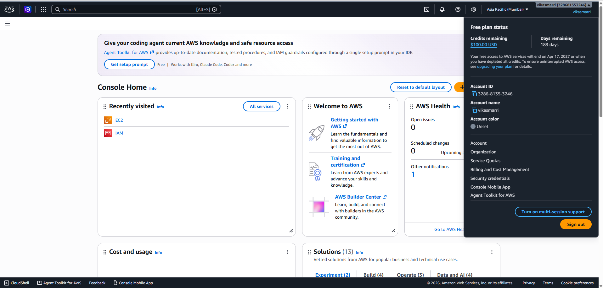

*Figure 1: AWS Account & Identity Verification — Host: AWS Management Console; Test: Identity check; Result: Account 328681353246, IAM user ewb-lab-user.*

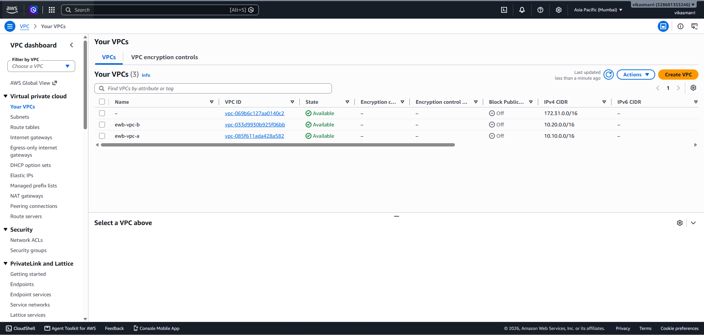

*Figure 2: VPCs Configuration — Host: AWS VPC Console; Test: VPC inventory verification; Result: ewb-vpc-a (10.10.0.0/16) and ewb-vpc-b (10.20.0.0/16) in Available state.*

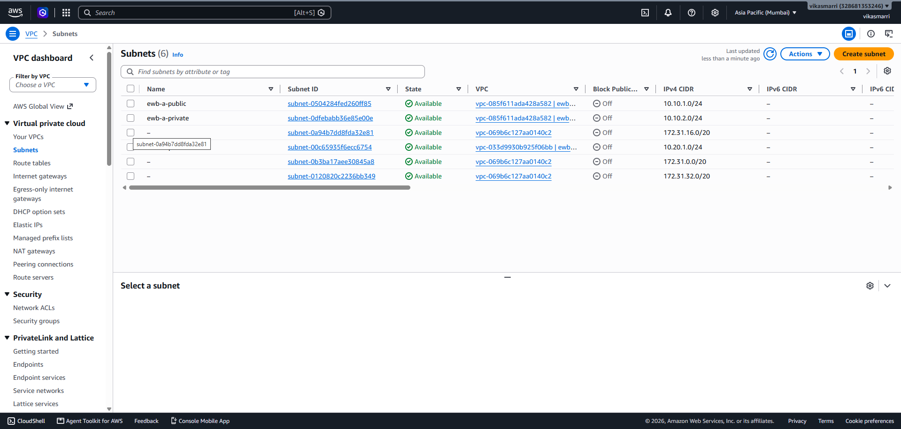

*Figure 3: Subnets Allocation — Host: AWS VPC Console; Test: Subnet CIDR audit; Result: ewb-a-public (10.10.1.0/24), ewb-a-private (10.10.2.0/24), and ewb-b-private (10.20.1.0/24).*

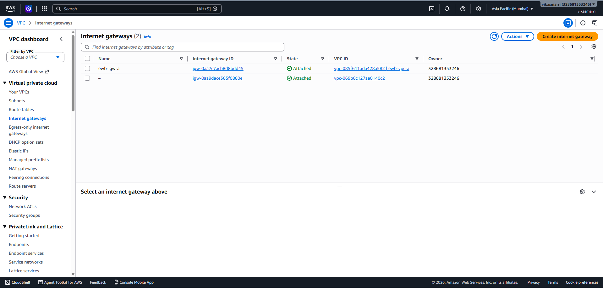

*Figure 4: Internet Gateway Attachment — Host: AWS VPC Console; Test: IGW scope; Result: ewb-igw-a attached to ewb-vpc-a; ewb-vpc-b has no IGW.*

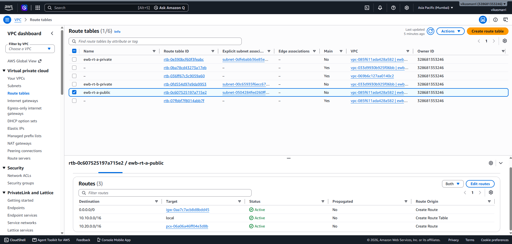

*Figure 5: VPC A Public Route Table Routes — Host: ewb-rt-a-public; Test: Route audit; Result: Local (10.10.0.0/16), default (0.0.0.0/0 -> IGW), and peering (10.20.0.0/16 -> pcx-06a06a46ff04e3d8b).*

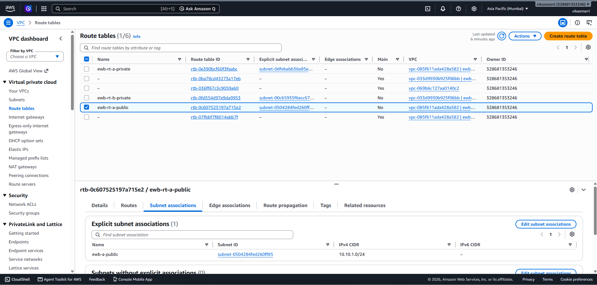

*Figure 6: VPC A Public Route Table Association — Host: ewb-rt-a-public; Test: Subnet association; Result: Associated with ewb-a-public (10.10.1.0/24).*

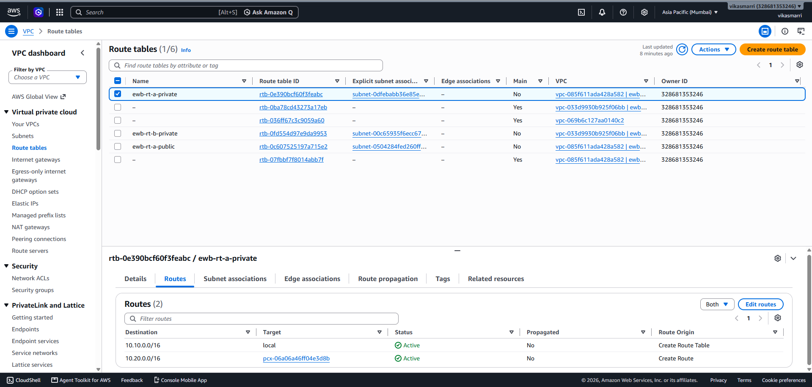

*Figure 7: VPC A Private Route Table Routes — Host: ewb-rt-a-private; Test: Route audit; Result: Local (10.10.0.0/16) and peering (10.20.0.0/16 -> pcx-06a06a46ff04e3d8b).*

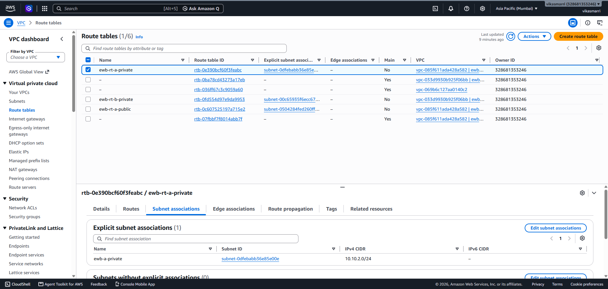

*Figure 8: VPC A Private Route Table Association — Host: ewb-rt-a-private; Test: Subnet association; Result: Associated with ewb-a-private (10.10.2.0/24).*

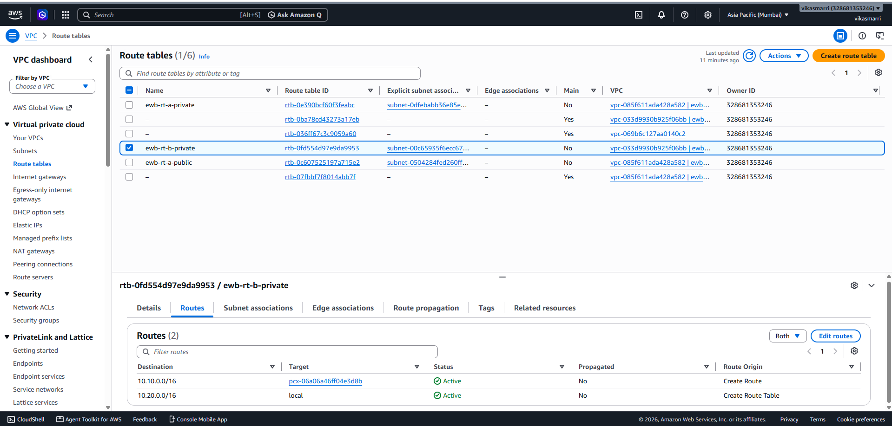

*Figure 9: VPC B Private Route Table Routes — Host: ewb-rt-b-private; Test: Route audit; Result: Local (10.20.0.0/16) and return peering (10.10.0.0/16 -> pcx-06a06a46ff04e3d8b).*

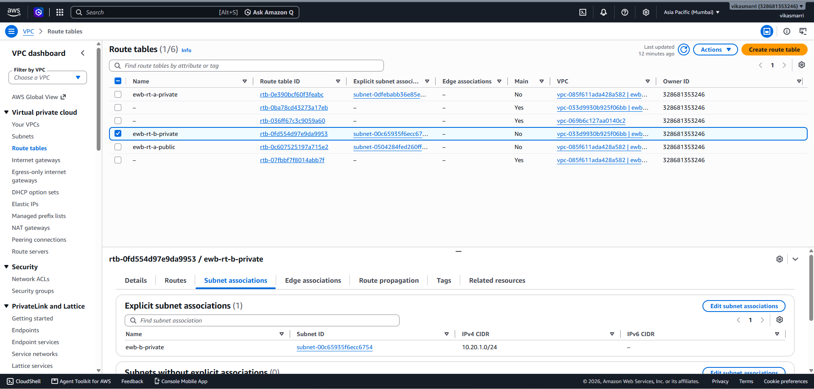

*Figure 10: VPC B Private Route Table Association — Host: ewb-rt-b-private; Test: Subnet association; Result: Associated with ewb-b-private (10.20.1.0/24).*

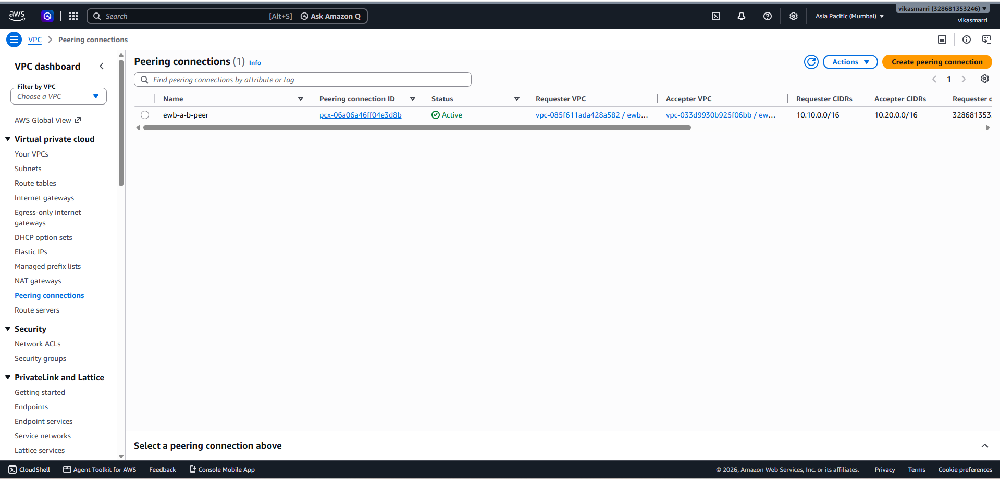

*Figure 11: VPC Peering Connection Active State — Host: AWS VPC Console; Test: Status check; Result: ewb-a-b-peer (pcx-06a06a46ff04e3d8b) is Active between VPC A and VPC B.*

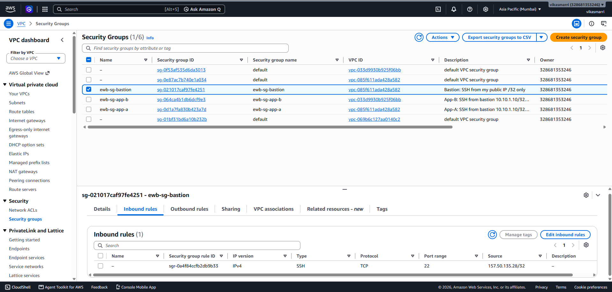

*Figure 12: Bastion Host Security Group Inbound Rules — Host: ewb-sg-bastion; Test: Inbound security audit; Result: TCP port 22 authorized strictly for operator's IPv4 157.50.x.x/32.*

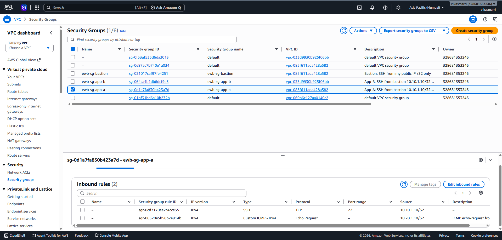

*Figure 13: App-A Security Group Inbound Rules — Host: ewb-sg-app-a; Test: Inbound security audit; Result: SSH from 10.10.1.10/32 and ICMP echo-request from 10.20.1.10/32.*

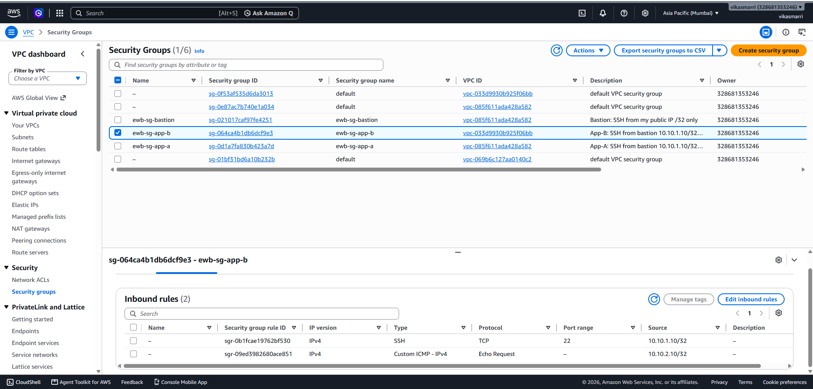

*Figure 14: App-B Security Group Inbound Rules — Host: ewb-sg-app-b; Test: Inbound security audit; Result: SSH from 10.10.1.10/32 and ICMP echo-request from 10.10.2.10/32.*

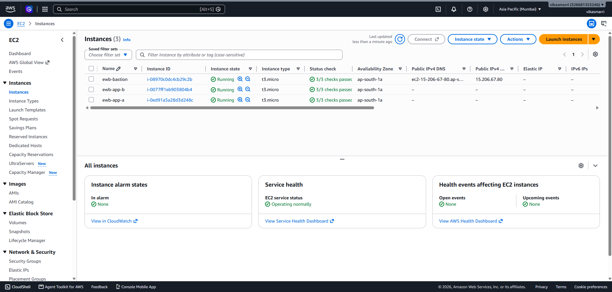

*Figure 15: EC2 Instances Inventory & Status — Host: AWS EC2 Console; Test: Compute audit; Result: ewb-bastion, ewb-app-a, and ewb-app-b running with 2/2 checks passed.*

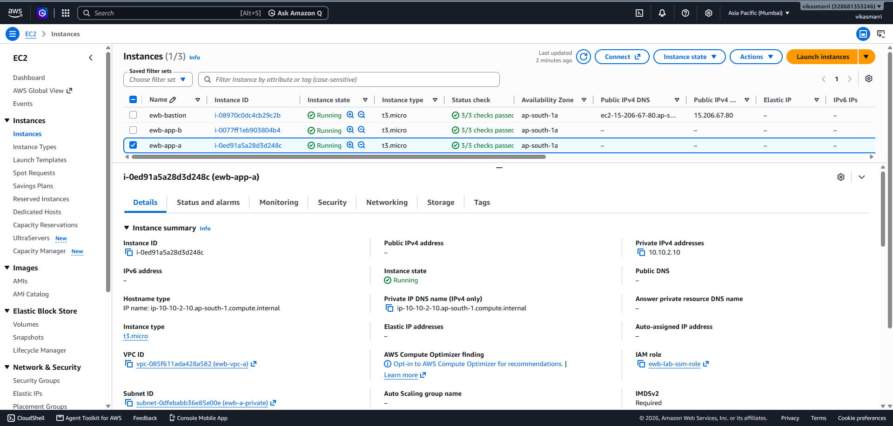

*Figure 16: Instance App-A Network Details — Host: ewb-app-a (i-0ed91a5a28d3d248c); Test: Network audit; Result: Bound to 10.10.2.10, no public IPv4 address assigned.*

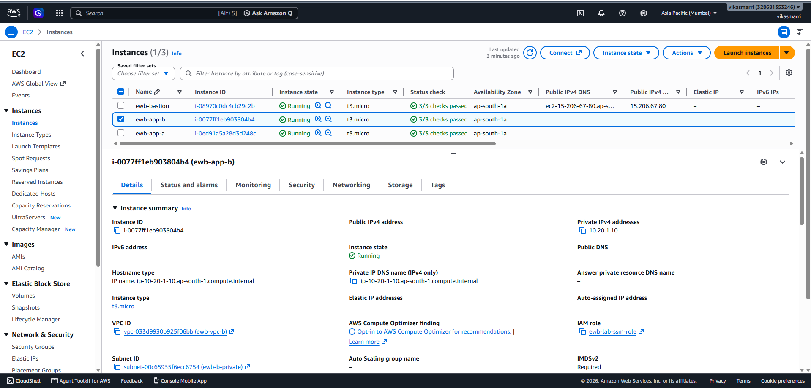

*Figure 17: Instance App-B Network Details — Host: ewb-app-b (i-0077ff1eb903804b4); Test: Network audit; Result: Bound to 10.20.1.10, no public IPv4 address assigned.*

---

## Cleanup

Upon successful execution and verification of all tests (Tests 01–05 and the controlled security group failure/recovery experiment), Stage 9 automated cleanup was executed via `vpc-peering-lab.ps1 -Cleanup`.

### Resources Terminated & Removed

1. **EC2 Instances (3):** Terminated `ewb-bastion` (`i-08970c0dc4cb29c2b`), `ewb-app-a` (`i-0ed91a5a28d3d248c`), and `ewb-app-b` (`i-0077ff1eb903804b4`).
2. **EBS Volumes (3):** Root volumes automatically terminated via `DeleteOnTermination=true`.
3. **VPC Peering Connection:** Peering routes deleted across all 3 route tables; connection `ewb-a-b-peer` (`pcx-06a06a46ff04e3d8b`) deleted.
4. **Security Groups (3):** Deleted `ewb-sg-bastion` (`sg-021017caf97fe4251`), `ewb-sg-app-a` (`sg-0d1a7fa830b423a7d`), and `ewb-sg-app-b` (`sg-064ca4b1db6dcf9e3`).
5. **Route Tables & Subnets:** Explicit associations removed; route tables (`rtb-0c607525197a715e2`, `rtb-0e390bcf60f3feabc`, `rtb-0fd554d97e9da9953`) deleted; subnets (`subnet-0504284fed260ff85`, `subnet-0dfebabb36e85e00e`, `subnet-00c65935f6ecc6754`) deleted.
6. **Internet Gateway & VPCs:** Gateway `ewb-igw-a` (`igw-0aa7c7acb8d8bdd45`) detached and deleted; VPCs `ewb-vpc-a` (`vpc-085f611ada428a582`) and `ewb-vpc-b` (`vpc-033d9930b925f06bb`) deleted.
7. **Key Pair:** Key pair `ewb-lab` (`key-0a80a06ea7407b2ff`) deleted from AWS.

### Verification of Complete Cleanup

Independent AWS CLI queries filtering for `Project=EWB-VPC-Peering` in region `ap-south-1` confirmed zero active lab resources remain:
- **Instances:** 0 running, pending, or stopped instances.
- **Volumes, Elastic IPs, Peering Connections, IGWs, SGs, Subnets, Route Tables:** All 0.
- **VPCs:** Only the default AWS VPC (`vpc-069b6c127aa0140c2`, `172.31.0.0/16`) remains intact and untouched.

**Evidence:** Full real-time execution and post-cleanup audit logs are captured in `evidence/09-cleanup.txt`.

